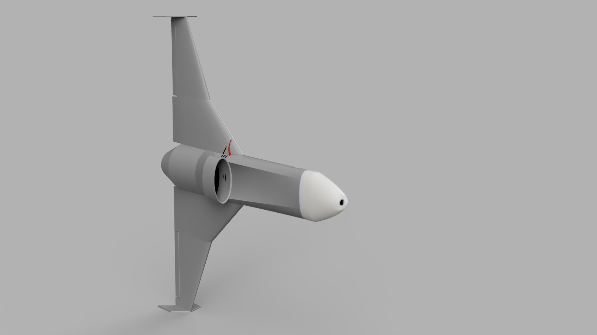
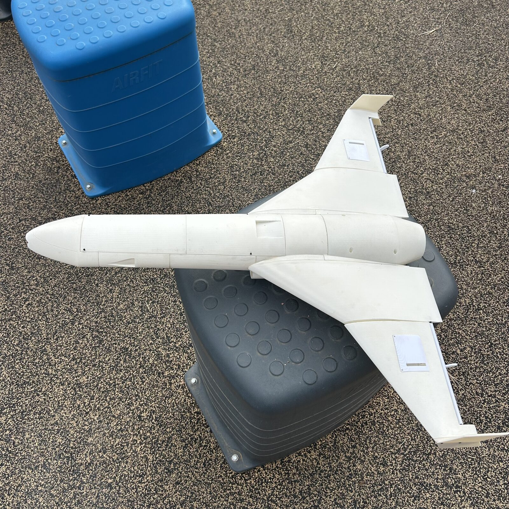
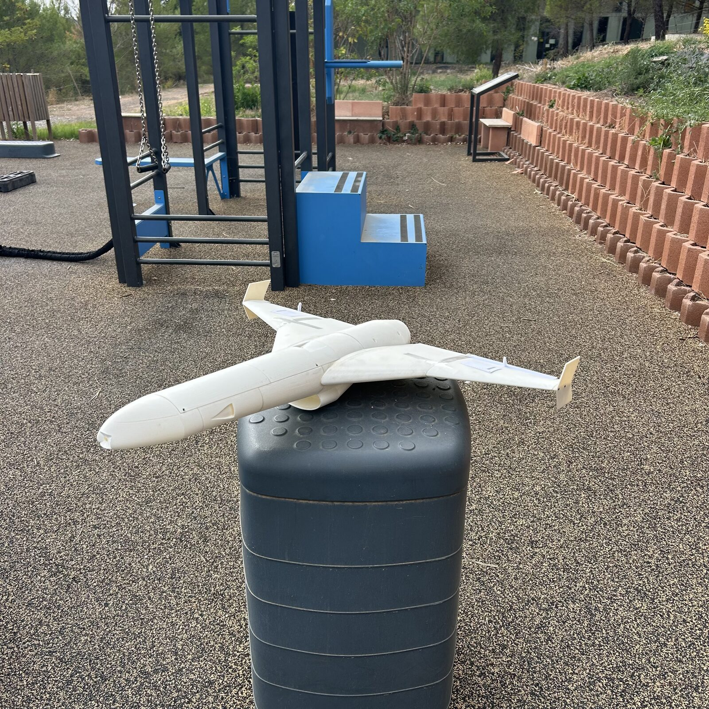
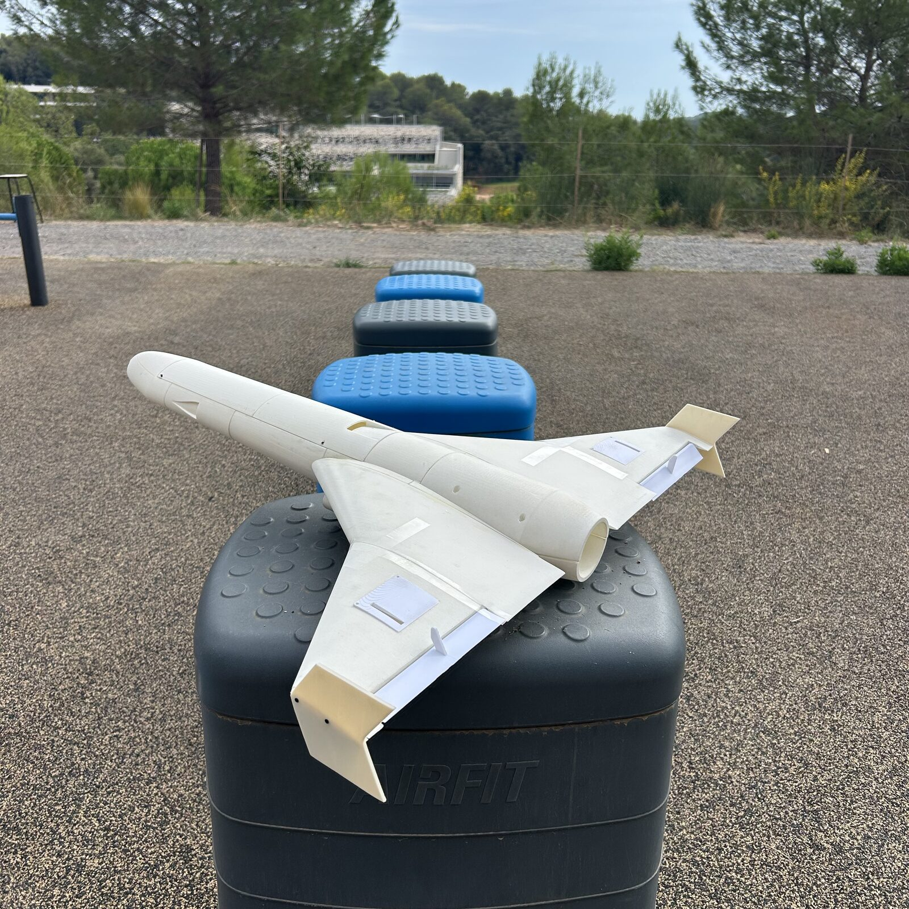
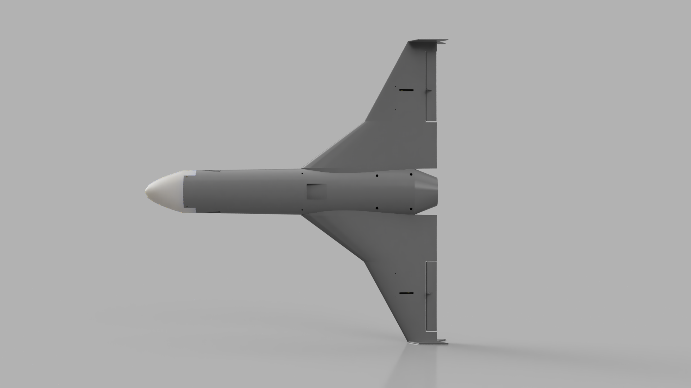
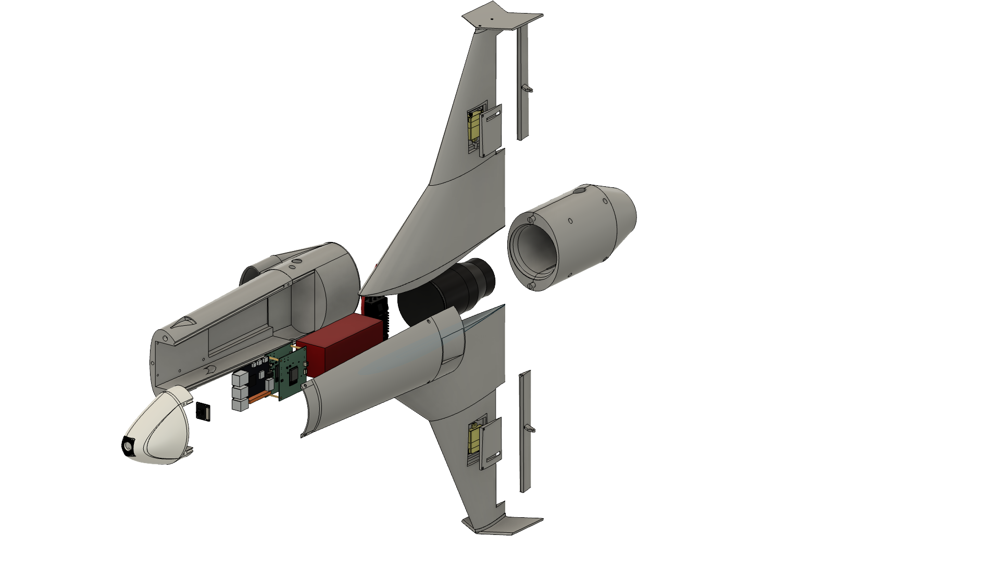
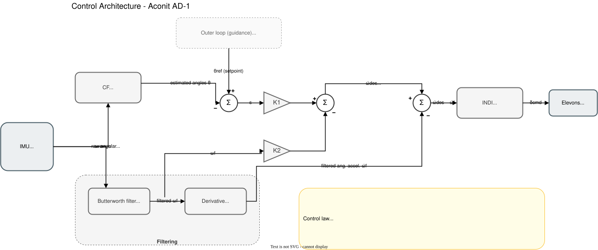

<h1 align="center">Aconit AD-1</h1>

<p align="center">
  <b>An EDF-powered double-delta flying wing — airframe, avionics and flight control built from scratch.</b>
</p>

<p align="center">
  
</p>

<p align="center">
  
</p>

---

## Overview

**AD-1** is an academic R&D project carried out by a team of two students: designing, building and flying a double-delta flying wing
propelled by an electric ducted fan (EDF), with **every layer developed in-house** —
from the 3D-printed airframe to the flight controller and its control law.

The aircraft is tailless: pitch and roll are controlled by two **elevons** driven by servos,
while yaw stability is passive, provided by vertical fins.

### Goals

1. **Phase 1 — Manual flight:** RC-piloted test flights (EDF throttle + elevons) to validate the airframe and propulsion.
2. **Phase 2 — Stabilised flight:** custom flight controller running an **INDI** attitude controller.
3. **Phase 3 — Autonomy:** guidance, navigation and onboard vision (camera + embedded AI on the RDK X5).

---

## Gallery

### Printed & assembled airframe

<p align="center">
  
  
  
</p>

### CAD

<p align="center">
  
  
</p>

<p align="center"><i>Left: top view of the double-delta planform. Right: exploded view showing EDF, ESC, battery, flight electronics and camera head integration.</i></p>

---

## System architecture

### Attitude control loop (pitch / roll)

<p align="center">
  
</p>

**Control law**

$$\dot{\omega}_{des} = K_1\,(\theta_{ref} - \hat{\theta}) - K_2\,\omega_f$$

$$\delta_{cmd} = \delta_0 + G^{-1}\,(\nu - \dot{\omega}_f)$$

- **K₁** maps angle error to desired angular acceleration [1/s²]; **K₂** damps the angular rate [1/s].
- **INDI** (Incremental Nonlinear Dynamic Inversion) computes an *increment* of elevon deflection from the
  measured angular acceleration, making the controller robust to model uncertainty — well suited to a
  flying wing whose aerodynamics are hard to model accurately.

Editable diagram: [`docs/architecture/`](docs/architecture/) · Background papers: [`docs/references.md`](docs/references.md)

---

## Hardware

| Subsystem | Component |
|---|---|
| Airframe | Double-delta wing, 3D-printed in lightweight PLA (15 % gyroid infill) |
| Propulsion | EDF + Hobbywing 120A V4 ESC |
| Power | 6S LiPo battery |
| Actuators | High-torque servos on two elevons |
| Flight controller | Custom board — ESP32-S3 + IMU, with an integrated PDB (power distribution board) feeding all subsystems *(in development)* |
| Navigation | GPS M100-5883 (GPS + compass) |
| Companion computer | D-Robotics RDK X5 (vision, embedded AI, autonomy) |

## Tech stack

**CAD** Fusion · **Fabrication** FDM 3D printing (PLA-LW, PETG) · **Firmware** C/C++ on ESP32-S3 (ESP-IDF, FreeRTOS) ·
**Control** INDI, complementary & Butterworth filtering · **Simulation** MATLAB / Simulink ·
**Companion** RDK X5, ROS 2, Python · **Docs** draw.io, Markdown

---

## Roadmap

- [x] Airframe design in Fusion (wing, fuselage, EDF intake & mount, electronics tray)
- [x] Control architecture (filtering + INDI attitude loop)
- [x] Airframe printing & assembly
- [ ] Propulsion bench test (thrust, current, temperature)
- [ ] Simulink model & INDI tuning
- [ ] Flight controller firmware (IMU drivers, filtering, INDI, servo output)
- [ ] First RC flight
- [ ] First stabilised flight
- [ ] Outer loop: altitude / airspeed hold, GPS navigation
- [ ] Onboard vision on the RDK X5

---

## Repository structure

```
AD-1/
├── docs/
│   ├── architecture/   # Control & system diagrams
│   ├── sizing/         # Sizing calculations (thrust, mass budget, CG…)
│   ├── devlog/         # Development log
│   └── references.md   # Scientific references
├── firmware/           # Flight controller firmware (ESP32-S3)
├── companion/          # RDK X5 software (vision, autonomy)
├── simulation/         # Models and controller tuning
└── media/              # Renders and photos
```

> **Note on CAD files:** source CAD models are intentionally not published. Renders are provided instead.

---

## Authors

**Alexandru Niculae** — Robotics student
[](https://www.linkedin.com/in/alexandru-niculae-11647227a)

**Vladimir Grigoriev** — Robotics student
[](https://www.linkedin.com/in/vladimir-grigoriev-nice/)
